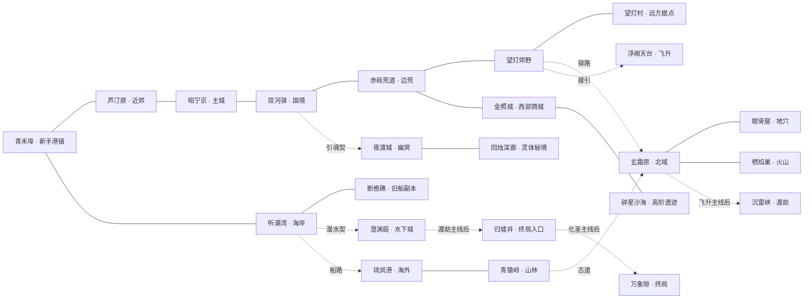

# 《照夜山海》世界地图关系稿

门派内容已按 0.2 版更新，23 个世界区域的连接关系保持不变。

本图用于确认区域连接、交通与内容投放。方位为策划示意，不代表实际比例、场景轮廓或最终美术。采用经典主城、国境、边荒、远村，以及海湾、海外、北域的连接体验；并非原作完整地图的逐点复刻。

下列关系是本项目拟定路线。所有连线均可往返；“主线后”表示首次完成条件后解锁。普通陆路不因推荐等级禁止通行。

## 1. 世界连接图

图中虚线用于区分特殊交通或条件入口，箭头不代表单向通行。实线为普通陆路或场景入口。后续快速旅行基于已到访据点，不列为地理邻接关系。

## 2. 区域内容表

推荐等级是当前版本的策划建议。城镇本身安全，城镇等级代表附近内容难度。

| ID | 地名 | 推荐等级 | 地貌与气质 | 主要活动／特色资源 |
| --- | --- | --- | --- | --- |
| QH | 青禾埠 | 1—8 | 潮汐河口、旧码头、晒网人家 | 新手主线、招募、初次打造；苇灵、砾背獭 |
| LT | 芦汀原 | 5—15 | 芦苇湿地与农田 | 普通宝图、草药、结契教学；苇芽精 |
| ZN | 昭宁京 | 10—35 | 河渠穿城、夜灯市集 | 门派传习、帮派入口、打造、赛事；执衡院与济世院驻地 |
| TC | 听潮湾 | 3—18 | 潮池、洞穴与退潮石桥 | 水栖灵兽、潮汐线索、海外船路；澄珠蟹 |
| DJ | 断桅礁 | 8—18 | 被礁石托起的旧船残骸 | 首个副本、排水机关、初级器灵碎片 |
| CY | 澄渊庭 | 20—45 | 水下石庭、发光水草 | 听潮阁、潮性血脉、深海工艺、归墟入口线索 |
| SH | 双河驿 | 18—30 | 两河交汇、商旅集散 | 绘契司、夜巡、商路委托、无声驿副本 |
| CL | 赤砾荒道 | 25—40 | 红色碎岩、废关与峡道 | 百骸谷、护送、荒性材料、帮派势力事件 |
| WD | 望灯郊野 | 32—45 | 古木、台地与千盏路灯 | 高级宝图线索、北域驿路、天台接引 |
| WC | 望灯村 | 35—50 | 山间聚落、灯匠与药圃 | 照灯坊、持续治疗工艺、负灯獾任务起点 |
| LL | 琉岚港 | 20—35 | 群岛港市、潮雾栈桥 | 绛罗坊、海外贸易、独立委托、巡潮鳐线索 |
| QY | 青猿岭 | 28—42 | 山果林、藤桥、雨雾石壁 | 林栖灵兽、隐蔽古道、采集型伙伴 |
| XS | 玄霜原 | 40—60 | 雪原、冻河与风蚀石林 | 寒性血脉、北域营地、地穴与火山入口；霜角兽 |
| MG | 眠骨窟 | 48—65 | 古兽骨架与地下泉脉 | 坚韧血脉、地穴精英、承伤工艺 |
| QYAO | 栖焰巢 | 52—70 | 火山裂隙与迁徙鸟巢 | 借火祭、热性血脉、耐焰工艺；燧羽雀 |
| FQ | 浮阙天台 | 45—60 | 悬空石台与天象观测塔 | 观星设施驭星台、飞升、衔星鹿任务线索 |
| YD | 夜渡城 | 45—70 | 亡者渡口与长夜集市 | 引魂夜巡、不眠集、灵体血脉；回声貘 |
| HZ | 回烛深廊 | 60—80 | 随记忆改变的地下街廊 | 高阶净化事件、灵体器灵、伙伴往事 |
| JZ | 金照城 | 35—55 | 西部绿洲、工艺坊与商馆 | 大师工艺、帮派订单、商路竞争 |
| SS | 碎星沙海 | 55—80 | 发光矿砂与移动沙丘 | 高级秘图遗迹、星矿、稀有配方 |
| SL | 沉雷峡 | 65—80 | 雷暴裂谷与悬空导雷柱 | 渡劫、劫印、保留资源的连续战斗 |
| GX | 归墟井 | 80—95 | 海底古井与失重水域 | 化圣前置主线、终局契器 |
| WX | 万象隙 | 90—100 | 多地地貌交叠的断契空间 | 化圣、归契之庭、领域构筑 |

## 3. 交通规则

### 陆路与驿站

青禾埠—芦汀原—昭宁京—双河驿—赤砾荒道—望灯郊野—望灯村构成内陆主干。首次通行包含手写事件与可见敌人，抵达并完成当地简短解锁后，可使用两端驿站快速往返。

赤砾荒道—金照城—碎星沙海为西部支线。金照城的工艺能力不阻塞主线基础打造；前期在昭宁京即可完成通关所需基础装备。

### 海外与北域

青禾埠—听潮湾为步行；听潮湾—琉岚港为船路，完成码头修复任务开放。琉岚港—青猿岭为步行；青猿岭—玄霜原为特殊古道，首次需要找到通路，之后可往返。

望灯郊野—玄霜原为驿路，首次需要修复驿站。北域两条路线形成环线，玩家可从海外或内陆抵达。眠骨窟、栖焰巢均从玄霜原进入。

### 水下、幽冥与天上

听潮湾—澄渊庭需要潜水契，通过海岸任务获得；双河驿—夜渡城需要引魂契，通过调查失踪商旅获得；望灯郊野—浮阙天台通过接引试炼进入。三个入口首次解锁均在地表完成，不要求先到目的地拿钥匙。

浮阙天台承载飞升，不以已飞升作为首次进入条件。驭星台为观星与神兽任务设施，不作为门派；七门派基础技能均可在主城传习院学习。

### 突破与终局

完成浮阙天台飞升主线后，从玄霜原进入沉雷峡；完成沉雷峡渡劫主线后，从澄渊庭进入归墟井；完成归墟井化圣主线后进入万象隙。

上述条件按剧情里程碑判定，不仅检查角色等级。首次进入后开启出口和安全点，可随时返回原世界继续支线；主线不产生无法返回的断路。

## 4. 门派与帮派场景

| 世界区域 | 第二级场景 | 用途 |
| --- | --- | --- |
| 昭宁京 | 执衡院／传习院 | 执衡门派剧情；七门派基础学习与试阵 |
| 昭宁京 | 济世院 | 群体治疗、攻防辅助、救援任务 |
| 昭宁京 | 帮派院落 | 议事厅、工坊、灵苑、藏书楼、药圃、演武场 |
| 双河驿 | 绘契司 | 封印、降防、夜巡案卷 |
| 赤砾荒道 | 百骸谷 | 兽相修行、物理群攻试炼 |
| 澄渊庭 | 听潮阁 | 群体法术、水栖共育 |
| 琉岚港 | 绛罗坊 | 暗器、速度、毒与封印 |
| 望灯村 | 照灯坊 | 持续治疗、复活、伙伴故事 |
| 浮阙天台 | 驭星台（非门派） | 观星、飞升与神兽任务 |

门派驻地内含生活区、任务区、试炼区三个基本部分，不从原作门派图追摹布局。地图标记表达入口位置，区域内部道路、建筑、NPC 分布和视觉地标另行原创设计。

## 5. 三条代表性游玩路线

1. 新手两小时路线：青禾埠招募 → 听潮湾结契 → 断桅礁副本 → 回青禾埠打造 → 芦汀原寻宝 → 抵达昭宁京。两小时为目标节奏，非时间限制。
2. 中期半小时路线：昭宁京接帮派委托 → 双河驿调查鬼患 → 赤砾荒道取得辅材 → 金照城解锁工艺 → 返回帮派培育并挑战地方论武。
3. 远游路线：听潮湾乘船 → 琉岚港接海外事件 → 青猿岭寻找古道 → 玄霜原探索 → 驿路抵达望灯郊野 → 接引进入浮阙天台。

每条路线至少包含一次战斗选择、一次养成收获与一个世界事件；不靠无事件的长距离移动制造游玩时长。

## 6. 美术方向

俯视或等距视角的手绘国风，强调各地生产与生活：海岸晒网、主城修渠、山村制灯、绿洲锻造、北域养兽。世界图以道路、船路与传送入口表现交通，不复描参考地图轮廓。

区域色彩与地标要让玩家不看地名也能辨认：青禾埠以潮汐水线和芦苇棚为标志；昭宁京以跨河灯桥与水闸为标志；望灯村以风动灯架为标志；夜渡城以逆流灯舟为标志。最终地形、建筑轮廓与 UI 图标需要独立美术设计。
