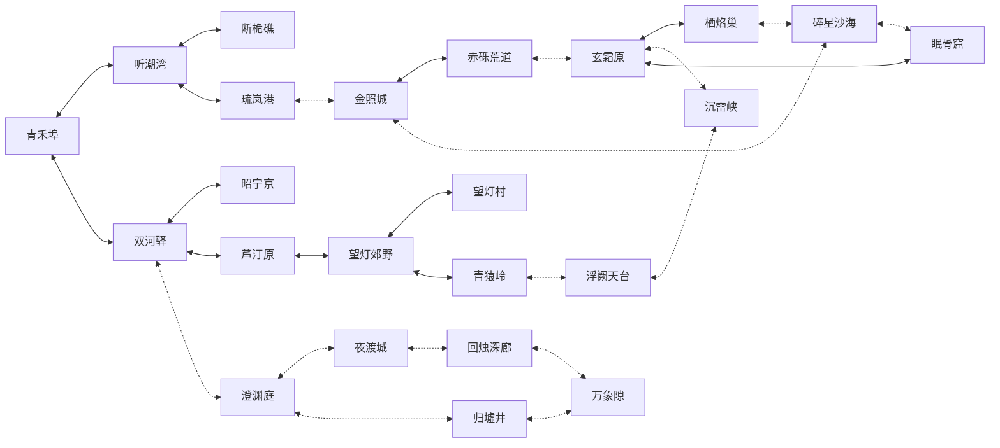

# 世界地图与区域设计

版本：0.6 · 2026-10-19 · 交通与职责重新设计，场景尚未制作。

本作围绕“上游用水、商路工程、余响证词”三个地区议题展开。双河驿是水陆枢纽；昭宁京只承担档案和评鉴，不再是各条路线必经的中心。青猿岭为内陆雾林，浮阙天台为山巅观象台，澄渊庭为地下蓄水庭。地图不是对现有游戏区域换名后的连接复刻。调整依据见 [独立设计调整说明](独立设计调整说明.md)。

## 1. 区域表

等级仅为危险度建议，不是硬性通行门槛。配置来源：[世界地图关系](数据/世界地图关系.json)。

| ID | 区域 | 建议等级 | 地区议题 | 功能 |
| --- | --- | --- | --- | --- |
| QH | 青禾埠 | 1—20 | 河源与民生 | 起点、上游水工院与远程授业 |
| LT | 芦汀原 | 8—35 | 河源与民生 | 洪泛平原、护运与草泽灵兽 |
| ZN | 昭宁京 | 20—70 | 工艺与商路 | 档案市场与工艺评鉴，非必经总枢纽 |
| TC | 听潮湾 | 10—40 | 河源与民生 | 下游港湾、潮汐调查与捕捉教学 |
| DJ | 断桅礁 | 15—50 | 河源与民生 | 沉船勘测与首个考古小遗迹 |
| CY | 澄渊庭 | 35—100 | 河源与民生 | 地下蓄水庭、古契馆与水位选择 |
| SH | 双河驿 | 10—80 | 工艺与商路 | 水陆转运枢纽、执衡联防营与行会仓站 |
| CL | 赤砾荒道 | 45—105 | 工艺与商路 | 货运旱道、风蚀遗址与山口修复 |
| WD | 望灯郊野 | 30—85 | 河源与民生 | 湿地观察、分支护林线 |
| WC | 望灯村 | 35—95 | 河源与民生 | 湿地聚落、迁居与保育选择 |
| LL | 琉岚港 | 30—85 | 工艺与商路 | 沿岸贸易、造船与船运订单 |
| QY | 青猿岭 | 55—115 | 余响与记忆 | 内陆雾林、古木索道与生态调查 |
| XS | 玄霜原 | 75—140 | 余响与记忆 | 高原交通交汇、济世救援站与雪灾援助 |
| MG | 眠骨窟 | 65—125 | 工艺与商路 | 旧矿洞外围骨工集落、设施与矿道 |
| QYAO | 栖焰巢 | 100—155 | 工艺与商路 | 地热研究与冷却矿轨 |
| FQ | 浮阙天台 | 90—150 | 余响与记忆 | 山巅观象与风缆试验，不是天宫主城 |
| YD | 夜渡城 | 65—130 | 余响与记忆 | 低水位旧河港、照灯舟坊与记忆证词 |
| HZ | 回烛深廊 | 110—165 | 余响与记忆 | 灯舟旧库、证词冲突与终局陆路 |
| JZ | 金照城 | 40—110 | 工艺与商路 | 沙河贸易城、绛罗戏坊与公开赛会 |
| SS | 碎星沙海 | 80—145 | 工艺与商路 | 星砂遗址、考古许可与旧矿铁路 |
| SL | 沉雷峡 | 125—170 | 余响与记忆 | 地磁风暴、跨区设施联动试炼 |
| GX | 归墟井 | 125—170 | 河源与民生 | 地下水源深探与终局水路 |
| WX | 万象隙 | 150—175 | 终局 | 三地契抉择汇流的终局与通关后挑战 |

## 2. 双向交通表

全部交通双向。条件永久达成后保持开放，不用真实日期、付费或固定境界限制进出；未满足时入口显示任务线索。返程、救援与安全传送不消耗稀缺道具。

| 连接 | 交通方式 | 首次开放条件 |
| --- | --- | --- |
| 青禾埠 ↔ 听潮湾 | 河道步行 | 默认开放 |
| 青禾埠 ↔ 双河驿 | 驿路 | 默认开放 |
| 双河驿 ↔ 昭宁京 | 城际道路 | 默认开放 |
| 双河驿 ↔ 芦汀原 | 堤道 | 默认开放 |
| 芦汀原 ↔ 望灯郊野 | 湿地小径 | 默认开放 |
| 望灯郊野 ↔ 望灯村 | 村道 | 默认开放 |
| 双河驿 ↔ 澄渊庭 | 闸门廊道 | 修复双河闸门 |
| 澄渊庭 ↔ 夜渡城 | 低水位旧航道 | 完成旧航道测绘并永久开启低水位航道 |
| 夜渡城 ↔ 回烛深廊 | 灯舟旧库入口 | 完成夜渡证词委托 |
| 听潮湾 ↔ 断桅礁 | 近海渡船 | 默认开放 |
| 听潮湾 ↔ 琉岚港 | 沿海客船 | 默认开放 |
| 琉岚港 ↔ 金照城 | 商船 | 完成首趟商船护运 |
| 金照城 ↔ 赤砾荒道 | 沙河驿道 | 默认开放 |
| 金照城 ↔ 碎星沙海 | 考古路线 | 取得考古许可 |
| 碎星沙海 ↔ 眠骨窟 | 旧矿通道 | 修复矿洞支架 |
| 眠骨窟 ↔ 玄霜原 | 高原矿道 | 默认开放 |
| 玄霜原 ↔ 栖焰巢 | 地热坡道 | 默认开放 |
| 玄霜原 ↔ 沉雷峡 | 峡口山路 | 建立抗雷信标 |
| 望灯郊野 ↔ 青猿岭 | 内陆林道 | 默认开放 |
| 青猿岭 ↔ 浮阙天台 | 古木索道 | 修复古木索道 |
| 浮阙天台 ↔ 沉雷峡 | 风缆 | 完成风缆试验 |
| 澄渊庭 ↔ 归墟井 | 深潜通道 | 取得深潜设备并完成救援演练 |
| 归墟井 ↔ 万象隙 | 水源裂口 | 三个地区地契分别作出一种决议，且完成归墟或回烛任一远征 |
| 回烛深廊 ↔ 万象隙 | 记忆裂口 | 三个地区地契分别作出一种决议，且完成归墟或回烛任一远征 |
| 赤砾荒道 ↔ 玄霜原 | 修复山口 | 组织行会修路 |
| 栖焰巢 ↔ 碎星沙海 | 冷却矿轨 | 完成地热导流工程 |

## 3. 连接示意

实线为默认开放，虚线为一次性任务开放，均可双向通行。

## 4. 七派驻地

门派设施不占独立世界节点；七派位置、子场景尺寸、入口、导师与坐标完整维护于 [门派设计](门派设计.md) 和上述 JSON。区域锚点采用左上原点的 0—1 归一化坐标，子场景采用逻辑格。落地时必须将入口、导师放在可行走格，坐标有效不等于寻路已验证。

青禾埠行会旅舍提供七派远程授业、转修和试招，均可研修至 180；选择远方门派不会迫使新手穿过高等级区域。正式驻地承载专属故事、工艺与导师关系，不提供必需的隐形战力加成。

## 5. 探索和成长

前段选择青禾埠、双河驿、芦汀原、听潮湾、断桅礁五区制作完整闭环，允许玩家先走堤岸调查或沉船勘测。中段从双河驿分入商路、地下水庭与湿地，行会订单可以帮助修路，但不强制经营满级才能推进主线。

三个地区地契为并行的治理决议：河源地区选择保育、迁居或分水；商路地区选择公营、协作或自治；余响地区选择保存、公开或安置证词。每条线的决定均能完成地区进度，奖励偏向路线、配方、伙伴关系和战术侧向选择，不形成三种依次升级的境界。

终局条件是三个地区各有决议，再完成归墟或回烛任一远征。两处裂口共享 final_access，进入同一个万象隙，不能因路线选择永久丢失结局。角色可以在建议 150—175 级挑战，不要求先到 175；175 是最终等级上限。通关后保留 180 级研修与可选挑战。

## 6. 场景落地与检查

World 维护节点、双向边、持久任务条件；Godot 维护美术、碰撞、出生点。剧情更改水位采用可保存场景状态，不依赖系统时钟。任务解锁要求可达的前置区域，避免“必须先通过该门才能取得开门任务”。

静态检查验证 23 节点、26 条唯一双向边、全开放连通、默认路线可达十个区域、终局双入口和七派坐标。实际制作另测出生点碰撞、门口回返、任务前置和寻路；JSON 是设计图，不会自动生成地图。
